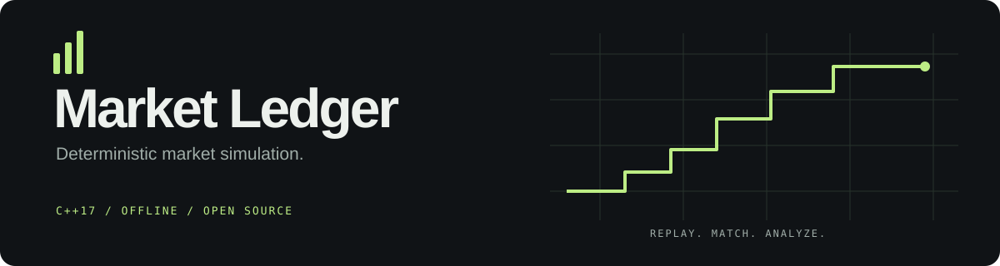

# Market Ledger

A portable C++17 trading simulator and market analysis toolkit by
[thejas-droid](https://github.com/thejas-droid). Replay limit orders, inspect
executions, and analyze cross-market spreads in a fully local workflow.

**Free to run. No accounts, API keys, paid data, hosting, or runtime packages.**

Market Ledger 1.0 is a portfolio and research release. It simulates trades and analyzes
synthetic quote data; it does not connect to a broker or place real orders.

| Order execution | Market analysis | Engineering |
| --- | --- | --- |
| Price-time priority and FIFO ties | Cross-market snapshot spreads | Portable C++17 core and CLI |
| Partial fills and inclusive expiry | Per-leg fees and liquidity caps | Integer-cent accounting |
| Self-trade prevention | Quote freshness limits | Randomized reference tests |
| Canonical basket instruments | Deterministic best-route selection | CMake and GitHub CI configuration |

## Run the demo

You need Python **3.9+** and a C++17 compiler: GCC, Clang, or Visual Studio 2022.
Python is used only for development tools and report generation; the compiled CLI
has no Python dependency. There is no `pip install` step.

With GCC or Clang available on `PATH`:

```sh
python tools/build.py --test
python tools/report.py
```

Open **`build/report.html`** in your browser. It includes session metrics, a traded
value chart, searchable/sortable executions, broker cash movements, and potential
cross-market routes. The HTML is self-contained and works offline. It can be
shared as a generated report, without a server. Regenerating overwrites this HTML
file; native JSON output files are protected from accidental overwrite.

The bundled synthetic session produces **12 orders, 6 executions, 13 instrument
units traded, $1,220.50 gross traded value, 1 expiry, and 1 self-trade prevention**.
The quote demo at a fee of 2 cents per unit per leg shows a potential ALPHA spread
of **$2.08** on 8 units. Potential spread is not realized profit.

### CMake / Visual Studio

```sh
cmake -S . -B build -DCMAKE_BUILD_TYPE=Release
cmake --build build --config Release --parallel 2
ctest --test-dir build -C Release --output-on-failure
python -m unittest discover -s tests -p test_tools.py -v
```

Visual Studio places the executable in `build/Release`. Generate its report with:

```sh
python tools/report.py --binary build/Release/market-ledger.exe
```

For the compiler-only build on macOS, select Clang using `CXX=clang++` in your
environment. On Windows, install a compiler with C++17 support or use Visual
Studio's CMake tooling. `tools/build.py` targets GCC/Clang; it does not invoke MSVC.

## Use the CLI

Windows PowerShell, after the compiler-only build:

```powershell
.\build\market-ledger.exe simulate --input examples/orders.csv
.\build\market-ledger.exe arbitrage --input examples/quotes.csv --fee 2 --max-age 5 --max-quantity 1000
.\build\market-ledger.exe simulate --input examples/orders.csv --output build/session.json
```

Linux/macOS:

```sh
./build/market-ledger simulate --input examples/orders.csv
./build/market-ledger arbitrage --input examples/quotes.csv --fee 2
```

Prices and fees are **integer cents**. Each command emits structured JSON. Invalid
input fails with a nonzero exit code and a clear message on stderr. The native
`--output` option refuses an existing readable file; choose a new filename for
subsequent runs. Use `--help` for all options.

Run the report generator with your own data:

```sh
python tools/report.py --orders path/to/orders.csv --quotes path/to/quotes.csv --fee 2 --output build/custom.html
```

Both sample datasets are synthetic and can be redistributed with the project.

## How it works

Each instrument has ordered bid/ask price levels with FIFO queues. A min-heap
expires resting orders before matching each new event. Incoming orders execute
against the best available opposing price at the resting order's price, with
partial fills and cash transfers recorded in an execution ledger.

Basket legs are canonicalized, so `ALPHA:1|BETA:2` and `BETA:2|ALPHA:1` share an
order book. Quote analysis uses the final snapshot and returns the best positive
route per instrument after fees, quote-age limits, and quantity caps.

The test suite compares matching results with an independent list-based reference
implementation over 20 seeded randomized sessions. It also checks FIFO priority,
expiry boundaries, duplicate IDs, malformed input, partial fills, fee calculations,
cash/quantity conservation, and output preservation. The CI workflow is configured
for Linux, Windows, macOS, and a Linux sanitizer build. Hosted CI results become
available after you upload the repository.

## Repository map

```text
include/market_ledger/   Public engine types and interface
src/                 Matching engine, scanner, CSV validation, CLI
examples/            Synthetic orders, quotes, and expected JSON reports
tests/               Engine, CLI, report, and release regression tests
tools/               Build, interactive report, and clean source export
docs/                Architecture, data contract, and portfolio/upload guide
.github/workflows/   Cross-platform CI and sanitizer checks
```

- [Architecture and matching semantics](docs/architecture.md)
- [CSV schemas and CLI contract](docs/data-format.md)
- [Portfolio description and GitHub upload steps](docs/portfolio.md)
- [Contributing](CONTRIBUTING.md) · [Security](SECURITY.md) · [Changelog](CHANGELOG.md)

## Publish your copy

```sh
python tools/export.py
```

Extract **`release/market-ledger-1.0.0-source.zip`** and upload the contents of its
`MarketLedger` folder to your GitHub repository. The export uses an explicit source
allowlist and includes SHA-256 manifests beside the ZIP. It excludes build
products, Git history, and environment files. See the
[upload guide](docs/portfolio.md#manual-github-upload) for exact steps.

## Scope and license

This version focuses on reproducible simulation. It does not model slippage,
market impact, general basket arbitrage, portfolio valuation, settlement, margin,
or real broker execution. Broker cash movements are not P&L. Snapshot spread
opportunities are not guarantees of execution or profitability.

Released under the [MIT license](LICENSE).
[Required third-party notices](THIRD_PARTY_NOTICES.md) are included with the source.
