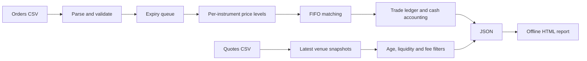

# Architecture and matching semantics

Market Ledger processes an ordered event stream on one thread. Identical input and
options produce identical JSON. A simulation owns all state; there are no global
mutable order books, worker timers, network sockets, or sleeps.



## Order matching

1. Validate the incoming order and reject reused IDs or decreasing timestamps.
2. Expire resting orders whose `timestamp + ttl` is less than the current time.
3. Visit the best opposing price level, then its oldest arriving order.
4. Match the smaller remaining quantity at the resting order's price.
5. Continue until the incoming order is filled, its limit cannot cross, or a
   resting order belongs to the same broker. In that last case cancel the incoming
   remainder and retain the resting order.
6. Store any remaining incoming quantity in its price level's FIFO queue.

Equal timestamps use CSV arrival order, rather than broker name, to break ties.
Expiry is **inclusive**: an order with time 5 and TTL 2 is valid through time 7.
TTL 0 is valid only at its submission timestamp; TTL -1 never expires. There is
no wall-clock advancement after the last event. Expired partially filled orders
count once; filled orders do not later count as expired.

The maps provide sorted prices. Deques preserve FIFO arrival order. A min-heap
tracks expiry deadlines. An ID map provides active-order lookup and a set prevents
ID reuse. Expiry removes the active order immediately; its queue entry is removed
lazily when visited. An order inserts/removes at a price level in O(log P), where
P is the number of price levels. Expiry costs O(log E) per heap entry. Processing a
fill or stale queue entry adds expected O(1) lookup work; matching is proportional
to the entries visited. Retained IDs, queue entries, deadlines, and trades use
O(N) space for N accepted orders.

Cash and quantity use signed 64-bit integers. At most 10,000 orders, 1,000,000
units per order, and 100,000,000 cents per unit bound session turnover by 10^18
cents, below the signed 64-bit limit. Cash transfers sum to zero, and every traded
unit is counted once on each side. No floating-point prices enter matching.

## Basket instruments

`ALPHA:1|BETA:2` represents one package with one ALPHA and two BETA units.
Legs are sorted and repeated coefficients combined; zero legs are removed.
`BETA:2|ALPHA:1` is therefore the same instrument. A unit basket such as
`ALPHA:1` becomes `ALPHA`. Coefficients can be negative. They are not rescaled,
so `ALPHA:2|BETA:4` is a different package. Empty exposure is rejected.

Prices, quantities, and broker bought/sold totals refer to whole packages. This
version matches identical packages; it does not solve general multi-leg basket
arbitrage, decompose baskets into individual fills, or value underlying positions.

## Arbitrage snapshots

Each quote replaces both sides for its `(instrument, venue)`. Analysis takes place
once, at the final input timestamp. A quote is eligible if its age is at most
`max-age`. The scanner considers distinct buy/sell venues for each instrument:

```text
quantity = min(buy ask size, sell bid size, quantity cap)
net per unit = sell bid - buy ask - 2 * per-leg fee
potential profit = quantity * net per unit
```

The best positive total-profit route is returned per instrument. Ties retain the
lexicographically first `(buy venue, sell venue)` pair. Quote sizes are not shared
across instruments, and route values are not summed into a portfolio return.
The scan is O(sum(V_i^2)) for V_i venues per instrument, after collecting the
latest quotes. No liquidity is consumed and no orders are sent. This is a spread
analysis tool rather than a fill simulation or a backtest of an executable strategy.

## Limits and boundaries

The library and CLI are intended for reproducible research and demonstrations.
There are no broker, live-feed, cancellation, amendment, persistence, authentication,
portfolio valuation, settlement, borrow, margin, slippage, or market-impact models.
The scanner fee is an assumed constant in cents per unit per leg. It does not
represent any particular broker's current fee schedule.

The HTML report requires integer values within JavaScript's exact range
(±9,007,199,254,740,991). Larger native reports remain valid 64-bit JSON data;
the HTML generator rejects them instead of silently rounding them. JSON consumers
must support 64-bit integers for the full simulator range.
